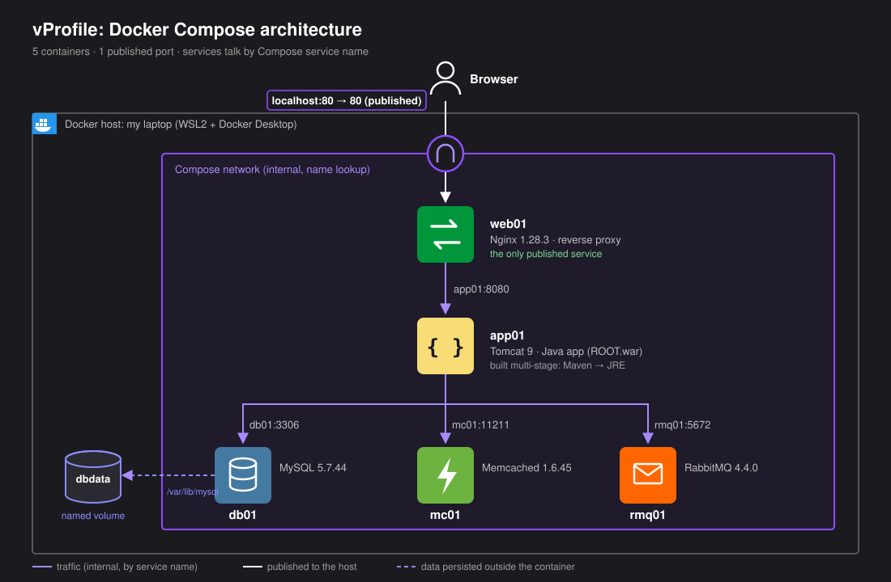
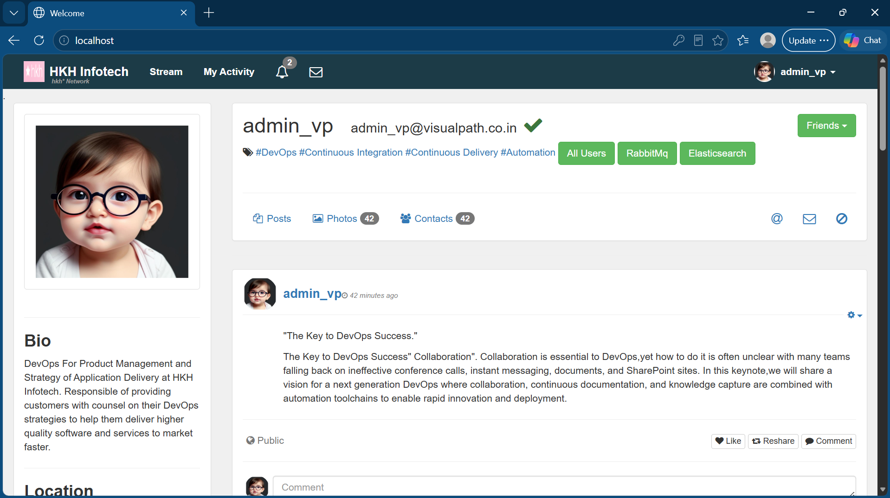
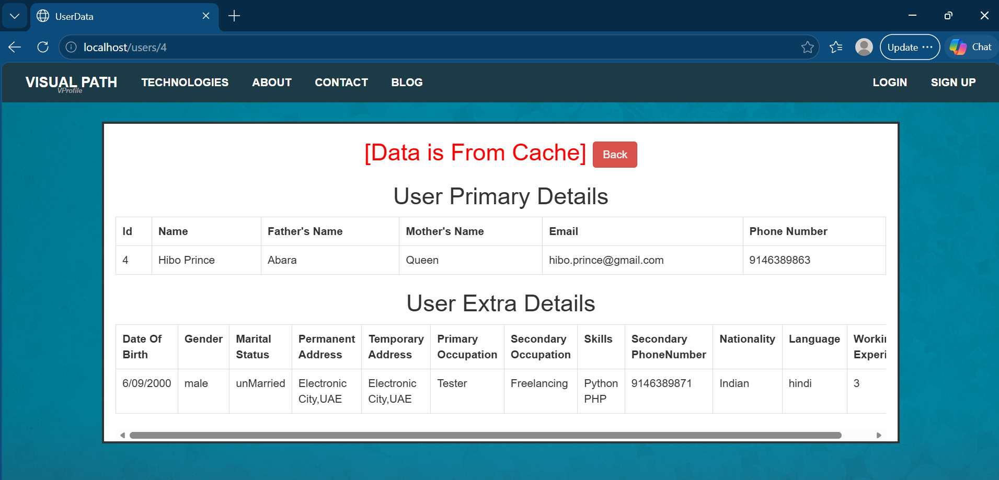
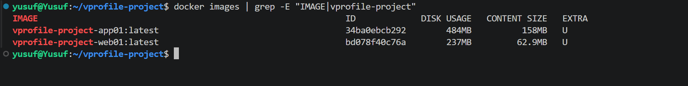
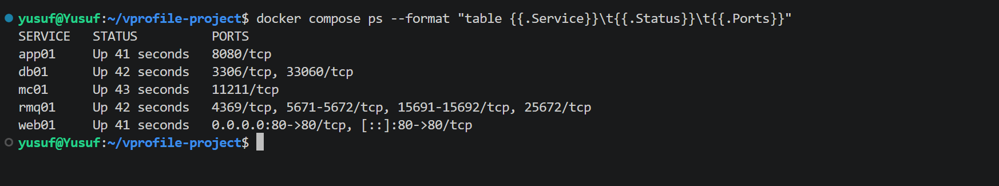
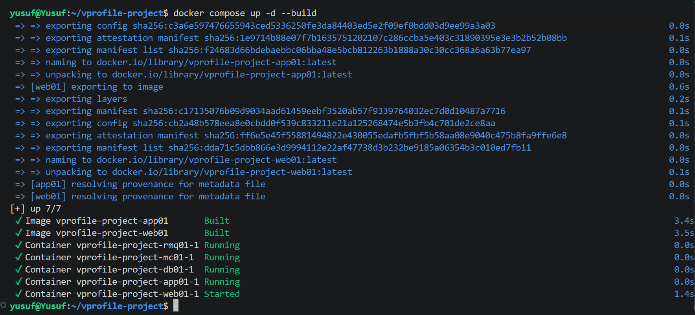
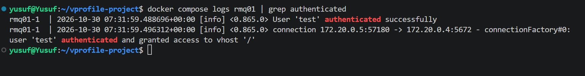

# vProfile: Multi-Tier Java Application on Docker Compose


<p align="center">
  
</p>

---

## Table of Contents

- [Overview](#overview)
- [Application Preview](#application-preview)
- [Architecture Overview](#architecture-overview)
- [Features](#features)
- [Repository Structure](#repository-structure)
- [Key Components](#key-components)
- [Design Decisions](#design-decisions)
- [Getting Started](#getting-started)
- [Lessons Learned](#lessons-learned)
- [Future Improvements](#future-improvements)

## Overview

A five-service Java web application containerised and run with **Docker Compose**. The original project is a manual setup across five virtual machines, with packages installed by hand, firewall rules opened per service and hostnames written into `/etc/hosts`. This version replaces all of that with two custom images, three official images and a single compose file.

Traffic enters through an **Nginx** reverse proxy, the only service with a published port, and is forwarded to a **Tomcat** application server. The application reads from **MySQL**, caches results in **Memcached** and connects to **RabbitMQ**, all reached over the Compose network by service name. The whole stack builds and starts with one command.

Forked from [hkhcoder/vprofile-project](https://github.com/hkhcoder/vprofile-project). The application code is the original author's; the containerisation is my own.

---

## Application Preview

→ `http://localhost` after `docker compose up -d --build`





---

## Architecture Overview

The stack runs on a single Docker host, with every service attached to one Compose network:

- **web01** (Nginx) is the single entry point, published on port 80
- **app01** (Tomcat) serves the Java application on port 8080, reachable only from inside the network
- **db01** (MySQL) stores application data on a named volume, initialised from a SQL dump on first start
- **mc01** (Memcached) caches database reads
- **rmq01** (RabbitMQ) provides the message broker
- Services find each other through Compose DNS by service name, replacing `/etc/hosts` entries

---

## Features

- Five services defined and started from one **Docker Compose** file
- **Multi-stage Docker build** for the Java application: Maven builds the `.war`, Tomcat runs it
- **Nginx reverse proxy** built as a custom image with its configuration baked in
- Only **one published port** (80); the application and backends are never exposed to the host
- **Named volume** for MySQL data, so data survives `docker compose down`
- Database **initialised automatically** from `db_backup.sql` on first start
- **Exact image versions pinned** for repeatable builds
- **`.dockerignore`** so unrelated changes no longer rebuild the Java application

---

## Repository Structure

```
vprofile-project/
├── nginx/
│   ├── Dockerfile                 # Extends nginx:1.28.3 with the proxy config
│   └── default.conf               # Forwards port 80 to app01:8080
├── src/
│   └── main/
│       ├── java/                  # Application source (original author)
│       ├── resources/
│       │   ├── application.properties   # Backend hostnames and credentials
│       │   └── db_backup.sql            # Database dump loaded on first start
│       └── webapp/                # JSP views (original author)
├── docs/
│   ├── architecture.svg           # Architecture diagram
│   └── *.png                      # Application and terminal screenshots
├── Dockerfile                     # Multi-stage build: Maven → Tomcat 9
├── docker-compose.yml             # All five services, network and volume
├── .dockerignore                  # Keeps unrelated files out of the app01 build
├── numbers.md                     # Measured image sizes and startup times
├── pom.xml                        # Maven build definition (Java 8, .war packaging)
├── ansible/  vagrant/  Jenkinsfile   # Original author's VM and CI setups, not used here
└── README.md                      # Project documentation
```

---

## Key Components

### Containers & Build

- **app01** uses a two-stage Dockerfile: `maven:3.10.0-eclipse-temurin-8` builds `vprofile-v2.war`, then only the `.war` is copied into `tomcat:9.0.123-jre8-temurin-noble` as `ROOT.war`
- Build tools never reach the final image, which is **158 MB**
- **web01** extends `nginx:1.28.3` with a single `COPY` of the proxy config, giving a **62.9 MB** image
- MySQL (`mysql:5.7.44`), Memcached (`memcached:1.6.45`) and RabbitMQ (`rabbitmq:4.4.0`) use official images, configured through environment variables and mounts rather than custom builds



> [!NOTE]
> Nginx is built as a custom image rather than mounting the config file, so the configuration travels inside the image and can be pushed to a registry and deployed as-is.

### Networking & Ingress

- Compose creates one network and attaches every service to it
- Services resolve each other by service name: `db01`, `mc01`, `rmq01`, `app01`
- The hostnames in `application.properties` match the service names, so the application needed no code changes
- Nginx proxies `/` to `http://app01:8080`
- Only `web01` has a `ports:` entry; `docker compose ps` shows no published ports on the other four



> [!NOTE]
> The original VM setup opens ports 3306, 11211, 5672 and 8080 in each server's firewall. Here none of them are reachable from the host, and Nginx remains the only public entry point.

### Data & Persistence

- The `dbdata` named volume is mounted at `/var/lib/mysql`
- `db_backup.sql` is bind-mounted into `/docker-entrypoint-initdb.d/`, so the MySQL image loads it on first start
- The init script only runs when the data folder is empty; on later starts the data comes from the volume
- Persistence was verified by running `docker compose down` then `up -d` and checking the tables were still present

> [!IMPORTANT]
> `docker compose down -v` deletes the named volume and the data with it. Plain `down` keeps it.

### Configuration & Versioning

- Every image is pinned to an exact patch version instead of a moving tag, including the three official service images
- Each version was confirmed from the running container before pinning, e.g. `docker exec vprofile-project-web01-1 nginx -v` and `docker exec vprofile-project-db01-1 mysqld --version`
- Application settings are baked into the `.war` at build time, so changing `application.properties` requires a rebuild
- `.dockerignore` excludes `.git`, `nginx`, `docker-compose.yml`, `docs` and the unused VM setups from the app01 build context
- After a change to `nginx/default.conf` only, `docker compose up -d --build` recreates web01 and leaves app01 running
- With the build context trimmed, an Nginx-only change rebuilds app01 from cache in **3.4 s**, compared with **46.6 s** when Maven has to run again



### Verification

- **Nginx → Tomcat → MySQL**: logging in as `admin_vp` through `http://localhost`
- **Memcached**: opening the same user twice; the first read returns *"Data is From DB and Data Inserted In Cache"*, the second *"Data is From Cache"*
- **RabbitMQ**: `docker compose logs rmq01` shows app01 connecting on port 5672 and `User 'test' authenticated successfully`



---

## Design Decisions

- **Tomcat 9, not 10**: the application uses `javax.servlet`; Tomcat 10 moved to the `jakarta` namespace
- **Java 8**: `pom.xml` targets Java 1.8, so both stages use Java 8 images
- **Tests skipped in the image build** (`-DskipTests`): the project's JUnit 4.10 is no longer supported by the current Maven Surefire plugin, and tests belong in a CI pipeline rather than the image build
- **ElasticSearch left out**: it is listed in the original project but has no setup steps, and the application runs without it
- **`depends_on` for start order**: backends start before app01, and app01 before web01

> [!NOTE]
> `depends_on` controls start order, not readiness. Healthchecks with `condition: service_healthy` would make app01 wait until MySQL is accepting connections.

---

## Getting Started

#### Prerequisites: Docker with Docker Compose installed on your machine.

#### 1. Clone the Repository

```bash
git clone https://github.com/yusufosman28/vprofile-project.git
cd vprofile-project
```

#### 2. Build and Start the Stack

```bash
docker compose up -d --build
```

#### 3. Access the Application

Open your browser and visit:

```bash
http://localhost
```

Log in with `admin_vp` / `admin_vp`.

#### 4. Stop the Stack

```bash
docker compose down
```

---

## Lessons Learned

- **JUnit Build Failure** - The first image build failed because the newer Maven Surefire plugin no longer supports the project's JUnit 4.10. I skipped tests in the image build with `-DskipTests` rather than changing the application code, and kept testing as a job for a future CI pipeline.

- **Build Context and `.dockerignore`** - Adding the Nginx service rebuilt the Java application as well, because `COPY . .` sends the whole repository as build context. I added a `.dockerignore` and proved it worked: after an Nginx-only change, only the Nginx container was recreated.

- **Moving Tags** - Checking the Nginx version with `docker run --rm nginx:1.28 nginx -v` pulled a newer image from Docker Hub instead of showing what my stack was built on. Running `nginx -v` inside the existing container with `docker exec` gave the version I had actually tested, which is the one I pinned.

- **Git Push 403** - My local `main` was tracking the original author's repository, so GitHub authenticated me but refused the push. Resetting the upstream with `git push -u origin main` pointed it at my fork.

---

## Future Improvements

Potential improvements to further mature the project include:

- Push the `app01` and `web01` images to `Amazon ECR` and run the stack on an `EC2` instance
- Add `healthcheck` blocks with `condition: service_healthy` so services wait for real readiness
- Run the test suite in `GitHub Actions` after updating JUnit to `4.13.2`
- Pin images by `digest` rather than tag
- Upgrade from MySQL 5.7, which is end-of-life, to a supported MySQL release
