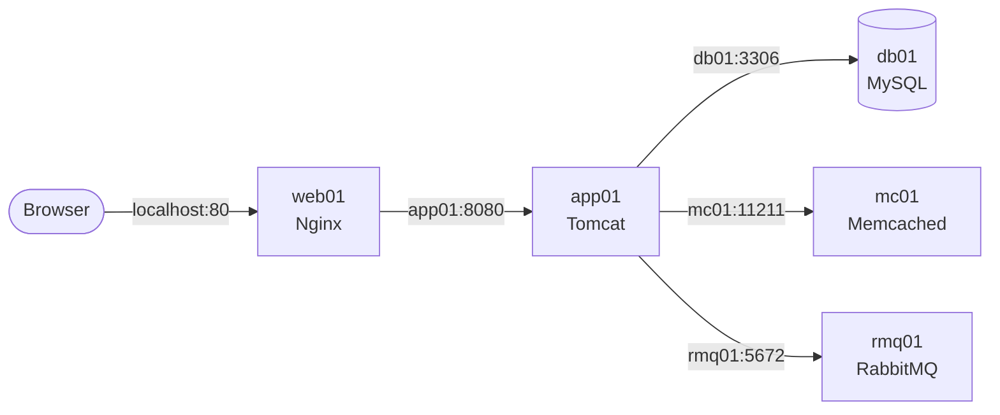

<h1 align="center">vProfile: Multi-Tier Java App in Docker Compose</h1>

<p align="center">
  
  
  
  
  
  
  
</p>

<p align="center">
  A 5-service Java web app, containerised and run with one command.<br>
  Forked from <a href="https://github.com/hkhcoder/vprofile-project">hkhcoder/vprofile-project</a>. The Docker setup is my own.
</p>

---

## 🏗️ Architecture



> **Only Nginx is published (port 80).** Everything else talks over the Compose network by service name and is never exposed to the host.

| Service | Image | Role |
|---|---|---|
| `web01` | custom, `FROM nginx:1.28.3` | reverse proxy, the **only** published port |
| `app01` | custom, multi-stage (Maven → Tomcat 9) | the Java app (`.war`) |
| `db01` | `mysql:5.7` | database, named volume + init script |
| `mc01` | `memcached:1.6` | cache |
| `rmq01` | `rabbitmq:4.4` | message broker |

---

## 🚀 How to run

**Requirements:** Docker with Compose.

```bash
git clone https://github.com/yusufosman28/vprofile-project.git
cd vprofile-project
docker compose up -d --build
```

Open **http://localhost** and log in with `admin_vp` / `admin_vp`.

**Stop it:** `docker compose down` (the data stays in the volume).

### ✅ Check every service works

| Check | How | Proves |
|---|---|---|
| Login | log in as `admin_vp` | Nginx → Tomcat → MySQL |
| Cache | All Users → click a user → Back → click the same user | first: *"Data is From DB and Data Inserted In Cache"*, second: *"Data is From Cache"* (Memcached) |
| Queue | `docker compose logs rmq01` | `User 'test' authenticated successfully` (RabbitMQ) |

---

## 🧠 Key decisions

| Decision | Why |
|---|---|
| **Multi-stage Dockerfile** | Maven builds the `.war` in stage 1; only the `.war` ships on a Tomcat JRE image, so build tools never reach the final image |
| **Tomcat 9, not 10** | the app uses `javax.servlet`; Tomcat 10 moved to `jakarta` |
| **Pinned image versions** | the same build every time; upgrades happen on purpose |
| **Nginx as a custom image** | the config travels inside the image, ready to push to a registry |
| **`.dockerignore`** | an Nginx-only change no longer rebuilds the Java app |
| **`-DskipTests` in the image build** | the project's JUnit 4.10 isn't supported by the newer Maven test plugin; tests belong in CI |

---

## 📚 What I learnt

- Compose resolves containers by **service name**, so the app's config hostnames must match.
- `depends_on` controls **start order, not readiness**.
- Settings are **baked into the image at build time**; changing them means a rebuild.
- Only the front door needs a **published port**.

📊 Measurements: [numbers.md](numbers.md)

---

## 🛣️ Roadmap

- [x] **Phase 1:** all 5 services running locally in Docker Compose
- [ ] **Phase 2:** push the images to AWS ECR and run the stack on EC2
